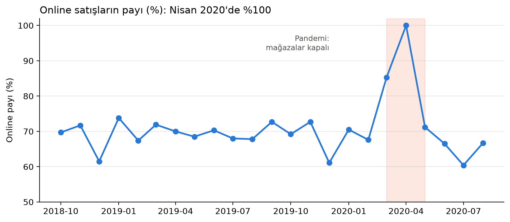
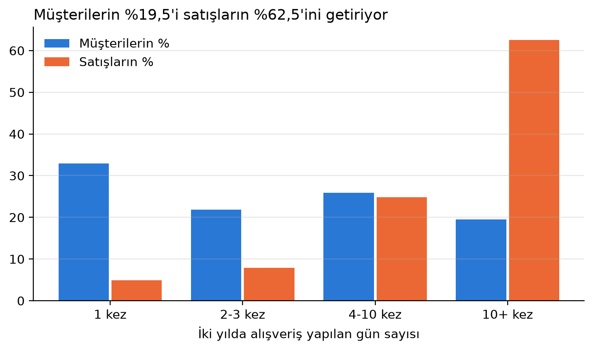
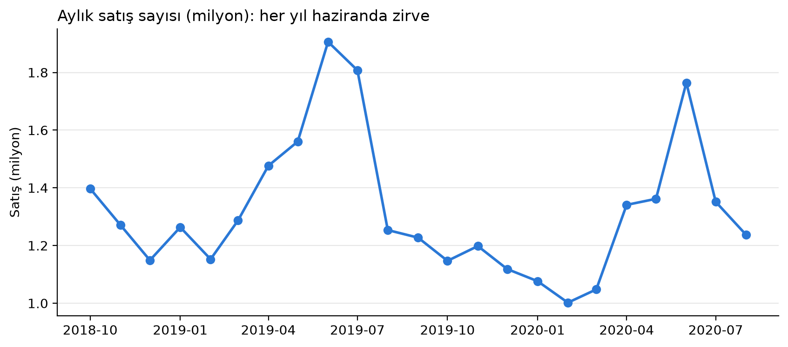
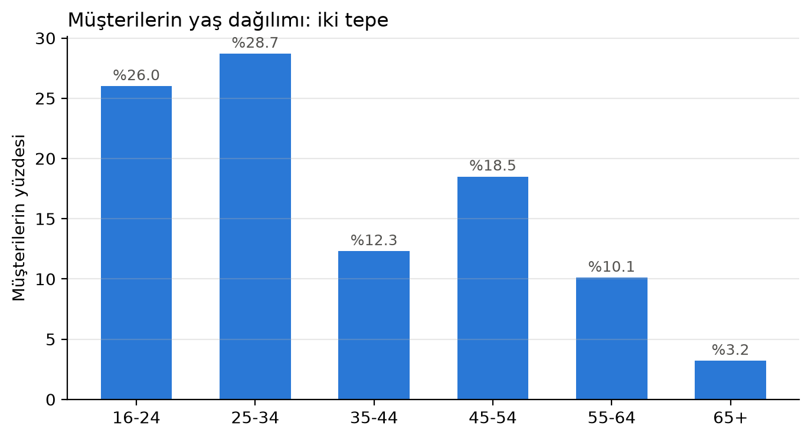

# H&M Müşteri ve Satış Analizi (SQL)

H&M'nin 2 yıllık gerçek (anonimleştirilmiş) satış verisiyle müşteri segmentasyonu, mevsimsellik, pandemi etkisi ve müşteri sadakati analizi. **31,8 milyon satış, 1,37 milyon müşteri ve 105 bin üründen** oluşan ilişkisel veri üzerinde SQL ile çalışıldı.

*Customer and sales analysis of H&M's anonymised transaction data (31.8M transactions, 1.37M customers) using SQL (DuckDB) and Python.*

**Araçlar:** SQL (DuckDB) · Python (pandas, matplotlib, scipy)
**SQL becerileri:** JOIN (üç tablo) · GROUP BY · CASE WHEN · WITH (CTE) · pencere fonksiyonları · tarih fonksiyonları
**İstatistik:** Kruskal–Wallis · etki büyüklüğü (ε²)

---

## İş sorusu

> H&M'nin müşterileri kim, ne zaman ve nasıl alışveriş yapıyor? Bulgulara dayanarak hangi pazarlama ve stok kararları alınabilir?

## Temel bulgular

| # | Bulgu | Kanıt |
|---|---|---|
| 1 | Müşterilerin **%19,5'i satışların %62,5'ini** getiriyor | İki yılda 10+ gün alışveriş yapan sadık çekirdek |
| 2 | Pandemi satışları **tamamen online'a** taşıdı | Nisan 2020'de satışların %100'ü online kanaldan |
| 3 | Satışlar **her yıl haziranda zirve** yapıyor | 2019: 1,91 M · 2020: 1,76 M aylık satış |
| 4 | Müşteri tabanı **iki tepeli** | 16–34 yaş %55 · 45–54 yaş %18,5 |
| 5 | Çocuk ürünü alımı **35–44 yaşta** zirve yapıyor | Satışların %10,2'si; diğer grupların 2–8 katı |
| 6 | **25–34** en değerli segment | En sık alışveriş (7,5 gün) ve en büyük sepet (3,95 ürün) |
| 7 | Yaş grupları arasındaki sıklık farkı anlamlı ama **küçük** | Kruskal–Wallis p < 0,001 · ε² ≈ 0,009 |

## Öneriler

- **Sadık çekirdeği büyütmek:** Düzenli alışveriş yapan (4–10 kez) müşterilere yönelik sadakat kampanyaları; sık gelen müşterilere yeni ürünleri öne çıkaran kişiselleştirilmiş içerikler.
- **Yaz sezonu hazırlığı:** Haziran zirvesi her yıl tekrarlandığından stok ve kampanya planlamasının mayıs sonuna kadar tamamlanması.
- **Segment bazlı iletişim:** Çocuk ürünü kampanyalarının 35–44 yaş grubuna, genç koleksiyonun 16–24 yaş grubuna yönlendirilmesi.
- **Online kanalın güçlendirilmesi:** Pandemide satışların tamamını taşıyabilen online kanal kriz dönemlerinde kritik bir güvence.

## Veri temizleme kararları

- **`FN` sütunu (%65 boş):** Boşlukların anlamı, bülten sıklığı sütunuyla çapraz doğrulandı (%98,6 uyum). Boş değer "bülten aboneliği yok" anlamına geliyor; satırlar silinmedi. Silinseydi müşterilerin üçte ikisi atılır ve analiz yalnızca bülten abonelerini temsil ederdi (seçim yanlılığı).
- **`age` sütunu (%1,2 boş):** Yaşı eksik müşteriler yalnızca yaş analizlerinde dışarıda bırakıldı.
- **Satış kanalı:** `sales_channel_id` değerleri resmî olarak açıklanmamış. Nisan 2020'de satışların tamamının kanal 2'den gelmesi (mağazalar kapalıyken), **1 = mağaza, 2 = online** yorumunu doğruladı.
- **Eksik aylar:** Veri 20.09.2018'de başlayıp 22.09.2020'de bittiğinden ilk ve son ay aylık grafiklerden çıkarıldı.

## Sınırlılıklar

- Veri yalnızca müşteriye bağlanabilen satışları içeriyor; mağazada üyelik kartı okutulmayan alışverişler büyük olasılıkla yok. Bu nedenle online payı gerçekte olduğundan yüksek görünebilir.
- Dönem sonuna yakın ilk alışverişini yapan müşteriler geri dönme fırsatı bulamadığından tek seferlik müşteri oranı olduğundan yüksek görünebilir (sansürleme).
- Fiyatlar H&M tarafından ölçeklendirildiğinden gerçek tutarlar yorumlanamıyor.
- Veri anonim olduğundan satışların hangi ülke ya da ülkelere ait olduğu bilinmiyor.

## Dosyalar

| Dosya | İçerik |
|---|---|
| `analiz.ipynb` | Tüm analiz: sorgular, tablolar, grafikler ve yorumlar |
| `sorgular.sql` | Analizdeki temel SQL sorguları |
| `figures/` | Grafikler |

## Çalıştırmak için

1. [Kaggle yarışma sayfasından](https://www.kaggle.com/competitions/h-and-m-personalized-fashion-recommendations/data) `articles.csv`, `customers.csv` ve `transactions_train.csv` dosyalarını indirip bu klasöre koyun. *(Veri boyutu ve yarışma kuralları nedeniyle depoda paylaşılmamıştır.)*
2. `pip install -r requirements.txt`
3. `analiz.ipynb` dosyasını açıp **Run All** ile çalıştırın. İlk çalıştırmada CSV dosyaları bir DuckDB veritabanına (`hm.duckdb`) aktarılır.

## Sonraki adımlar

- Sadık müşterilerin yeni çıkan ürünlere daha fazla yönelip yönelmediğinin incelenmesi
- Ürün kategorilerine göre mevsimsellik analizi
- Müşteri yaşam boyu değeri (CLV) ve kohort (ilk alışveriş ayına göre) analizleri
